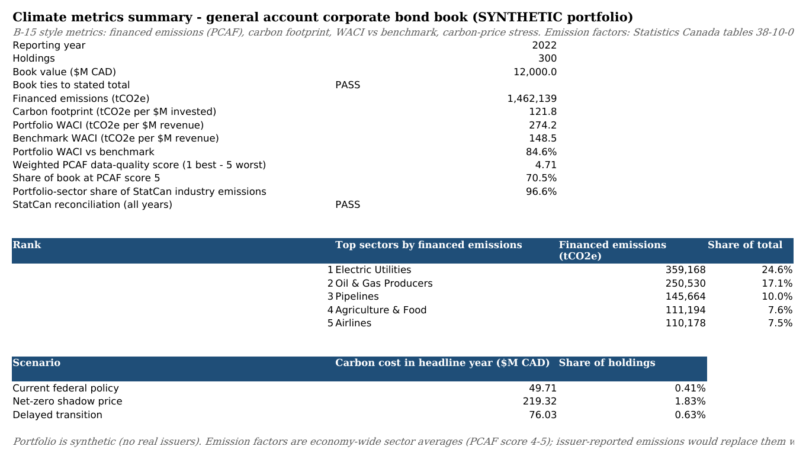

# Financed emissions and carbon-price stress workbook

Measured with Statistics Canada sector emission factors, a synthetic $12B CAD corporate bond book comes out 85% more carbon-intensive than the Canadian economy: a WACI of 274 tCO2e per $M revenue against a benchmark of 149. This repo holds the Excel workbook that produces that number. It takes raw StatCan rows, turns them into emission factors, attributes emissions to 300 holdings using the PCAF method and prices them under three carbon-price paths, and every step is a live formula. I built it around the climate metrics that OSFI Guideline B-15 asks Canadian insurers to disclose. A Power BI model reproduces the same figures.



The Summary sheet for reporting year 2022 shows the headline metrics, the five sectors with the most financed emissions and the 2030 carbon cost under each scenario.

## Running it

```bash
sudo apt-get install -y libreoffice-calc && python3 -m venv .venv && .venv/bin/pip install -r requirements.txt
.venv/bin/python scripts/build_all.py          # StatCan snapshots -> emission factors -> financed_emissions.xlsx, Power BI extracts, briefing
.venv/bin/python scripts/verify_workbook.py    # recalculate in LibreOffice and check every formula cell against pandas
```

Then open `financed_emissions.xlsx` and change one of the yellow cells on the Inputs tab, such as the reporting year, a carbon price or a sector's revenue/EVIC proxy. Every tab recalculates. A short write-up for an investment committee is in `reports/briefing.md` and the data audit trail is in `reports/reconciliation.md`.

The tests run with `.venv/bin/python -m pytest -q`, and `scripts/check_pbip.py` checks the Power BI project.

## How it works

The data comes from two StatCan tables: greenhouse gas emissions by industry (38-10-0097-01) and gross output by industry (36-10-0488-01). `scripts/fetch_statcan.py` downloads them once and keeps the Canada rows, about 1.2 MB, so the rest of the build runs offline. I had planned to use the GDP-by-industry table instead of gross output. It turned out to publish only provinces and territories, on NAICS codes, while the output table uses the same IOIC codes as the emissions account. Gross output avoided a second crosswalk, so I went with it.

A crosswalk maps all 124 IOIC codes to 22 portfolio sectors. If StatCan publishes a code the crosswalk doesn't know, the build fails. Each sector's emission factor is its emissions divided by its gross output. A holding's financed emissions are then its share of the issuer (outstanding over EVIC) times issuer revenue times that factor. Only 30% of the synthetic holdings have revenue on file. The rest use a sector proxy, which puts 71% of the book at PCAF data-quality score 5, the lowest.

Reconciling the source data was harder than I expected. The industry rows add up to StatCan's published totals within rounding in all 15 years. But the account's total is 28 to 53 Mt a year higher than the National Inventory Report. The account counts emissions by residence (a Canadian airline's fuel burned abroad still counts), while the inventory is territorial. StatCan publishes bridge items for the difference, and they close the gap to within 3 kt.

To trust the workbook I needed a second calculation path. `build_workbook.py` writes only formulas, and `twin.py` recomputes everything from the CSVs in pandas. LibreOffice recalculates the file headless, and the verifier matches all 8,646 formula cells one-to-one against pandas values, so a formula without a check fails as well as a wrong one. The 18 Power BI DAX measures each have a pandas twin that gets compared against the workbook in the same way.

Formulas, scenarios and data sources: [docs/methodology.md](docs/methodology.md)
Workbook tabs and full 2022 results: [docs/workbook.md](docs/workbook.md)
Tests, verification and opening the Power BI project: [docs/checks.md](docs/checks.md)

## Known issues and next steps

- The DAX measures have never been run. Their pandas twins are tested, but the DAX itself is only checked for syntax and references.
- Every issuer in a sector gets the same intensity, and the factors cover direct (Scope 1) emissions only. Loading issuer-reported Scope 1 and 2 data where it exists, with sector factors as the fallback, would be the next step.
- The emission factors and benchmark weights use gross output, not revenue or GDP. Value-added weights would need a NAICS-to-IOIC bridge.
- The book is synthetic and only the current-policy price path follows the federal schedule. The other two paths and all free-allocation shares are assumptions, and the stress is static (no emission cuts or cost pass-through).

Project period: 2026-09-13 to 2026-09-25.
