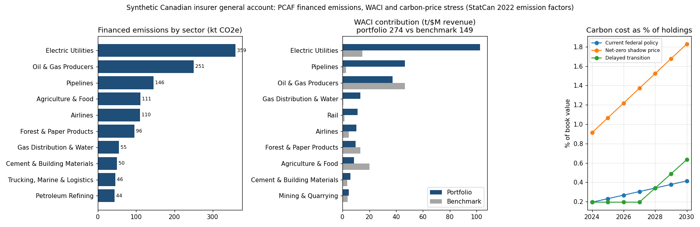

# Financed Emissions & Carbon-Price Stress Workbook

An Excel workbook (with a matching Power BI model) that gives an ESG analyst at a Canadian insurer the OSFI B-15 climate metrics for a general-account bond book (PCAF financed emissions, WACI against a benchmark and carbon-price stress), with every number traced to Statistics Canada data.

## Results

- **All 8,646 live formula cells match an independent pandas recalculation** after headless LibreOffice recalculation (tolerance 1e-6), for a synthetic $12B CAD book of 300 holdings.
- **StatCan GHG industry rows reconcile to published totals in all 15 years** (2009-2023, largest gap 5 kt), feeding tCO2e-per-$M emission factors for 22 portfolio sectors.
- **The book's carbon intensity is 85% above an economy-weighted benchmark**: WACI 274 vs 149 tCO2e per $M revenue, with five sectors producing 67% of financed emissions.
- **2030 carbon cost rises from 0.41% of holdings under current federal policy to 1.83% under a net-zero shadow price**, mirrored by 18 Power BI DAX measures whose pandas twins match the workbook on 295 values.



**Stack:** Microsoft Excel (SUMIFS, XLOOKUP, VLOOKUP, INDEX-MATCH, SUMPRODUCT, scenario tabs) · openpyxl · Python · pandas · LibreOffice (headless recalculation) · Power BI (PBIP, TMDL, DAX) · matplotlib · pytest · Statistics Canada open data

## Quickstart

```bash
sudo apt-get install -y libreoffice-calc && python3 -m venv .venv && .venv/bin/pip install -r requirements.txt
.venv/bin/python scripts/build_all.py          # StatCan snapshots -> emission factors -> financed_emissions.xlsx, Power BI extracts, briefing
.venv/bin/python scripts/verify_workbook.py    # recalculate in LibreOffice and check every formula cell against pandas
```

Open `financed_emissions.xlsx`, change a yellow cell on **Inputs** (reporting year, a carbon price, the free-allocation share, a sector's revenue/EVIC proxy) and every tab recalculates. The committee pre-read is [`reports/briefing.md`](reports/briefing.md); the data audit trail is [`reports/reconciliation.md`](reports/reconciliation.md).

## Why this exists

OSFI [Guideline B-15](https://www.osfi-bsif.gc.ca/en/guidance/guidance-library/climate-risk-management) requires federally regulated insurers to disclose climate metrics, including financed emissions measured with the [PCAF Global GHG Accounting and Reporting Standard](https://carbonaccountingfinancials.com/standard). For most corporate bond issuers, issuer-reported emissions are missing, so analysts fall back on PCAF's sector-based approach (data-quality score 4-5) using official emission factors. The investment committee and auditors then need to see where every figure comes from. This workbook keeps the whole chain live in Excel, from raw StatCan rows through the crosswalk, emission factors, attribution and scenarios, and a separate pandas model checks every formula cell.

## How it works

```
data/raw/ (pinned StatCan CSVs)                       data/reference/ (crosswalk, sector proxies, price paths)
        │                                                        │
scripts/fetch_statcan.py ─► build_data.py ─► emission factors, reconciliation report
                                 │
make_portfolio.py (seeded synthetic book) ─► build_workbook.py ─► financed_emissions.xlsx (live formulas)
                                                                       │
                       twin.py (independent pandas) ◄─ verify_workbook.py (LibreOffice recalculation, every cell)
                                                                       │
export_powerbi_data.py ─► powerbi/ PBIP (TMDL + DAX) ◄─ check_pbip.py + dax_twins.py (one pandas twin per measure)
                                                                       │
make_briefing.py ─► reports/briefing.md, docs/overview.png
```

### Data sources (Statistics Canada, open, no key)

| Table | Content | Use |
|---|---|---|
| [38-10-0097-01](https://www150.statcan.gc.ca/t1/tbl1/en/tv.action?pid=3810009701) | Physical flow account for greenhouse gas emissions, kt CO2e by industry (IOIC codes), 2009-2023 | Sector emissions, reconciliation, NIR bridge |
| [36-10-0488-01](https://www150.statcan.gc.ca/t1/tbl1/en/tv.action?pid=3610048801) | Output by industry, $M current dollars, same IOIC codes, 1997-2022 | Emission-factor denominator, benchmark weights |

`scripts/fetch_statcan.py` downloads both full tables and keeps the Canada rows in `data/raw/` (about 1.2 MB). The rest of the build runs offline from those committed snapshots. The GDP-by-industry table 36-10-0402-01 was considered, but it publishes only provinces and territories on NAICS codes, while 36-10-0488-01 uses the same seven-character IOIC codes as the emissions account, so no second crosswalk is needed.

### Methodology

- **Crosswalk.** `data/reference/sector_crosswalk.csv` maps all 124 StatCan IOIC industry codes to 22 portfolio sectors, plus three out-of-scope buckets: government and non-profit, owner-occupied dwellings, and fictive industries. The build fails if StatCan publishes a code the crosswalk does not map.
- **Emission factor** (tCO2e per $M CAD) = sector emissions (kt × 1000) ÷ sector gross output, for each sector and year 2009-2022 (`SUMIFS` over the raw StatCan tabs). The **Inputs** tab picks the reporting year (default 2022, the latest year both tables cover).
- **PCAF financed emissions** (corporate bonds) = attribution factor × issuer revenue × sector EF, where attribution factor = outstanding ÷ EVIC. If issuer revenue is on file the holding gets data-quality score 4. If not, revenue = EVIC × the sector revenue/EVIC proxy and the score is 5.
- **Carbon footprint** = financed emissions ÷ $M invested. **WACI** (TCFD/B-15) = Σ portfolio weight × issuer intensity (tCO2e per $M revenue). With sector factors, the issuer intensity equals the sector EF.
- **Benchmark** = each sector's share of Canadian gross output in the reporting year. The Benchmark Comparison tab shows active weights, contribution differences and an allocation effect, (w_p − w_b) × (EF − WACI_b), which sums to the WACI gap.
- **Carbon-price scenarios** = financed emissions × price × (1 − free-allocation share):

| Scenario | 2024 | 2026 | 2028 | 2030 | Free allocation |
|---|---:|---:|---:|---:|---:|
| Current federal policy (OBPS benchmark, +$15/t a year) | 80 | 110 | 140 | 170 | 80% |
| Net-zero shadow price (illustrative) | 150 | 200 | 250 | 300 | 50% |
| Delayed transition (illustrative: frozen to 2027, then catch-up) | 80 | 80 | 140 | 260 | 80% |

### Workbook tabs

| Tab | Contents |
|---|---|
| Summary | Headline B-15 metrics, top-5 sectors (`LARGE` + `INDEX/MATCH`), headline-year scenario costs, reconciliation flag |
| Inputs | Reporting year, stated book total, headline year, price paths, free-allocation shares, revenue/EVIC proxies (yellow input cells) |
| Emission Factors | Sector × year emissions, output and EF (`SUMIFS`), plus the reporting-year lookup table |
| Crosswalk | StatCan code → portfolio sector |
| Holdings | 300 synthetic holdings: sector, instrument, rating, outstanding, EVIC, revenue (blank = not on file) |
| Financed Emissions | Per-holding attribution (`XLOOKUP`, `VLOOKUP`, `ISBLANK`), PCAF score, plus a sector roll-up (`COUNTIF`, `SUMIFS`, `SUMPRODUCT`) |
| WACI | Sector weights × EF, sector and holding-level WACI, carbon footprint |
| Benchmark Comparison | Portfolio vs output-weighted benchmark, active weights, allocation effect |
| Carbon Price Scenarios | Effective price, cost ($M) and cost as % of holdings by scenario and year; sector costs in the headline year |
| Reconciliation | Industry rows vs published totals per year, gap to the NIR and the published bridge |
| StatCan GHG / StatCan Output / StatCan Totals | Raw source rows, each with a `VLOOKUP` sector mapping |

## Full results (reporting year 2022, synthetic book)

| Metric | Value |
|---|---:|
| Book value / holdings / sectors | $12,000M CAD / 300 / 22 |
| Financed emissions | 1,462,139 tCO2e |
| Carbon footprint | 121.8 tCO2e per $M invested |
| WACI, portfolio vs benchmark | 274.2 vs 148.5 tCO2e per $M revenue (+85%) |
| Weighted PCAF data-quality score | 4.71; 71% of the book at score 5 |
| Portfolio sectors' share of StatCan industry emissions | 96.6% |

| Top sectors by financed emissions | tCO2e | Share | Share of book |
|---|---:|---:|---:|
| Electric Utilities | 359,168 | 24.6% | 10.0% |
| Oil & Gas Producers | 250,530 | 17.1% | 6.0% |
| Pipelines | 145,664 | 10.0% | 7.0% |
| Agriculture & Food | 111,194 | 7.6% | 3.0% |
| Airlines | 110,178 | 7.5% | 1.5% |

| 2030 scenario | Carbon cost ($M CAD) | Share of holdings |
|---|---:|---:|
| Current federal policy | 49.7 | 0.41% |
| Net-zero shadow price | 219.3 | 1.83% |
| Delayed transition | 76.0 | 0.63% |

Reconciliation (from `reports/reconciliation.md`): industry rows match `Total, industries` within rounding in every year from 2009 to 2023 (largest gap 5 kt, against a tolerance of 54-57.5 kt). The account's industries-plus-households total exceeds the National Inventory Report by 28-53 Mt a year. The gap comes from the basis: the account follows the SNA **residence** principle (resident carriers' fuel burned abroad counts), while the inventory is **territorial**. StatCan's published bridge items close the gap to within 3 kt.

## Tests and checks

```bash
.venv/bin/python -m pytest -q                  # 43 tests
.venv/bin/python scripts/verify_workbook.py    # every formula cell vs pandas after LibreOffice recalculation
.venv/bin/python scripts/check_pbip.py         # PBIP text validation + each DAX measure's pandas twin vs the workbook
```

- `tests/test_data.py`: snapshot coverage, every StatCan code mapped, per-year reconciliation, NIR bridge, output coverage, an emission factor traced back to the raw rows, and synthetic-book shape and seeding.
- `tests/test_workbook.py`: every formula cell matches pandas; no hard-coded numbers on derived tabs; scenario and reporting-year inputs flow through after recalculation, and the edited workbook still verifies; the verifier catches a tampered formula and a formula cell with no pandas value.
- `tests/test_dax_twins.py`: one test per DAX measure (twin vs workbook in each filter context); every measure has a twin and every twin has a measure; table, column and measure references in the DAX and report pages resolve; negative checks for a wrong twin and an unknown column.
- `tests/test_briefing.py`: the briefing reports the model's headline numbers and the committed copy is current.

## Design notes

- **Two independent calculation paths.** `build_workbook.py` writes formulas only, and `twin.py` recomputes from the CSVs with pandas without reading any formula. The verifier requires a one-to-one match between formula cells and pandas values, so a new formula without a check fails, and so does a check whose cell is not a formula.
- **Inputs are read from the workbook.** The twin reads assumptions from the Inputs tab, so an edited workbook can be re-verified as it stands. The sensitivity tests depend on this.
- **LibreOffice as the calculation engine.** `soffice --headless --convert-to xlsx` recalculates on load (the file is saved with `fullCalcOnLoad`) and writes cached values that openpyxl can read. It uses a private profile under `$TMPDIR` and leaves nothing running.
- **Power BI without rendering.** The PBIP project (`powerbi/`) has a TMDL semantic model with three tables, a relationship, two calculated columns and 18 measures, plus three report pages: emissions by sector, WACI vs benchmark and scenario carbon-cost exposure. It is validated as text. Each measure has a pandas twin over the same CSV extracts, evaluated in the contexts the report uses (total, per sector, per scenario-year), and each twin value is compared with the workbook cell for the same metric. To open it in Power BI Desktop, set the `DataFolder` parameter to the absolute path of `powerbi/data/`.
- **Synthetic, clearly labelled book.** `make_portfolio.py` is seeded. Issuers are named `SYN <sector> NN Corp`, sector weights are illustrative of an insurer's corporate book (`data/reference/sector_assumptions.csv`), and 30% of holdings have revenue on file.

## Limitations and next steps

- **No DAX engine runs here.** The DAX measures were not executed. Their pandas twins are tested against the workbook, but the DAX text itself is checked only for syntax and references, not evaluated.
- **Sector averages only.** Every issuer in a sector gets the same intensity, and the factors cover direct (Scope 1) emissions of the industry. Next step: load issuer-reported Scope 1+2 where available (PCAF scores 1-3) and keep sector factors as the fallback.
- **Gross output, not revenue.** The EF denominator is StatCan gross output and the benchmark is weighted by output share, used as a GDP proxy. Value-added (GDP) weights would need a NAICS-to-IOIC bridge.
- **Corporate bonds only.** There are no sovereign, provincial or municipal bonds, mortgages or real-estate equity, each of which has its own PCAF method.
- **Illustrative scenario paths.** Only the current-policy path follows the federal OBPS schedule. The net-zero and delayed paths and all free-allocation shares are assumptions to edit. The stress is static: no emission reductions, cost pass-through or spread impact.
- **Single reporting year per run.** The year can be switched on the Inputs tab (2009-2022), but year-over-year attribution of changes is not built yet.
- **Synthetic portfolio.** The results describe a seeded synthetic book, not any real insurer.

Project period: 2026-09-13 to 2026-09-17.
